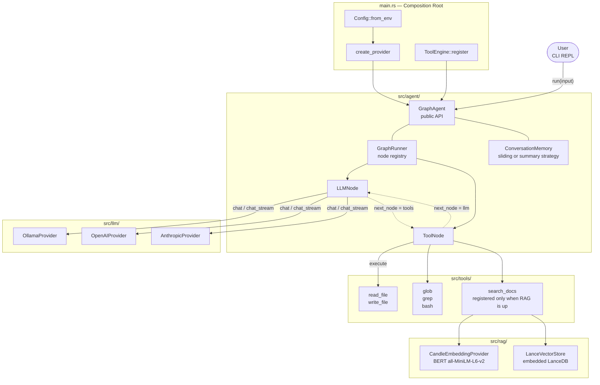
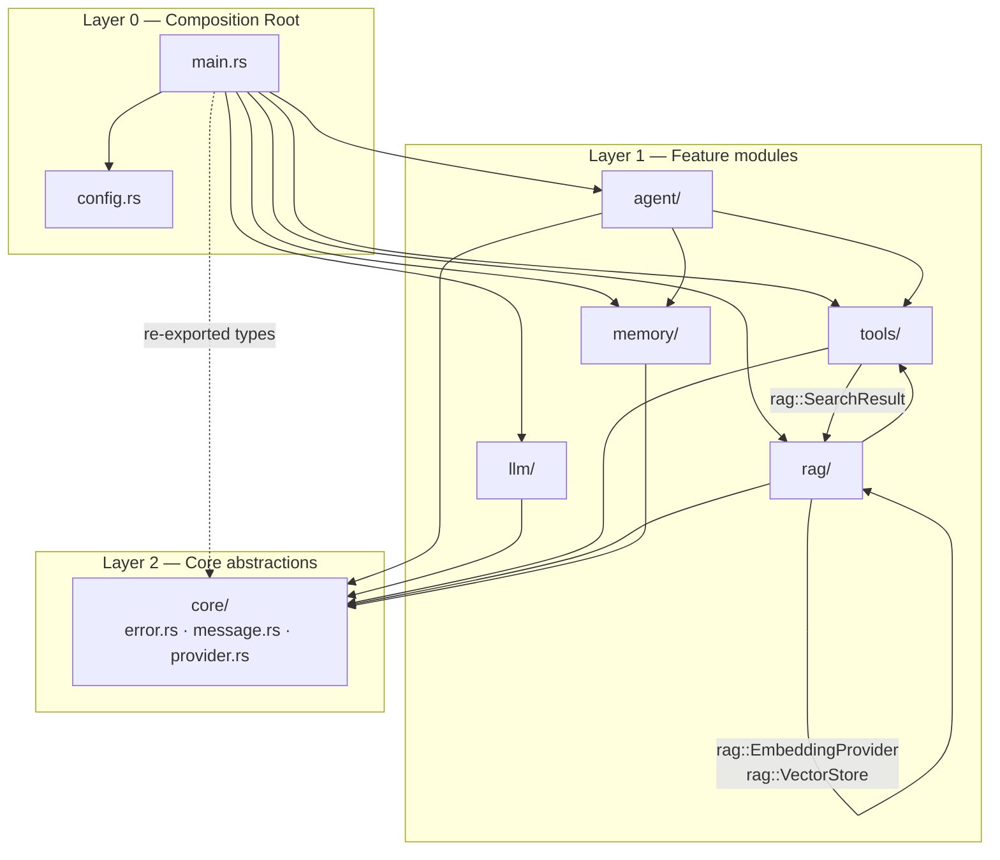
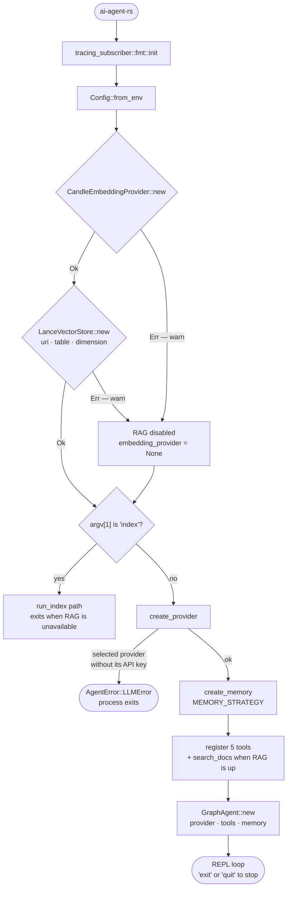
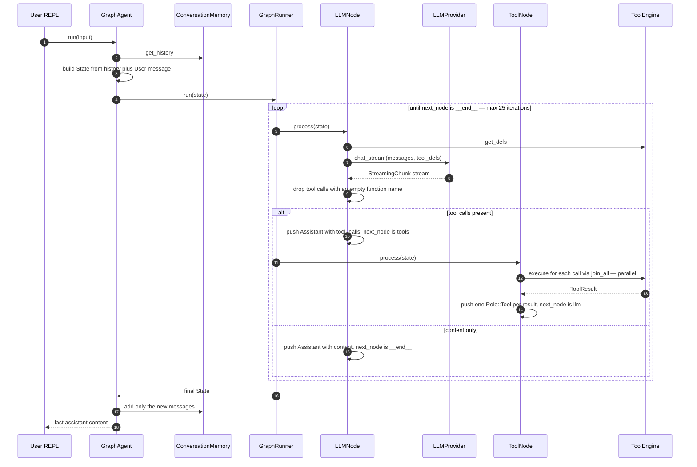
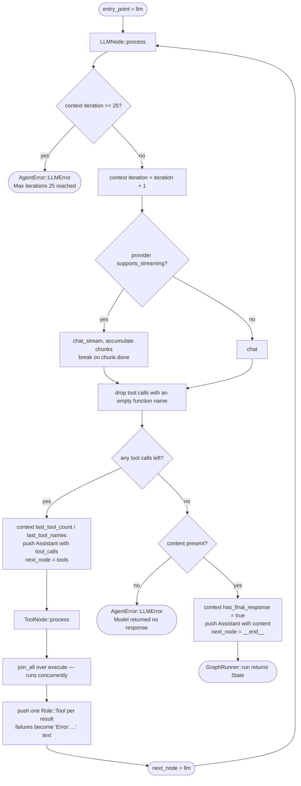
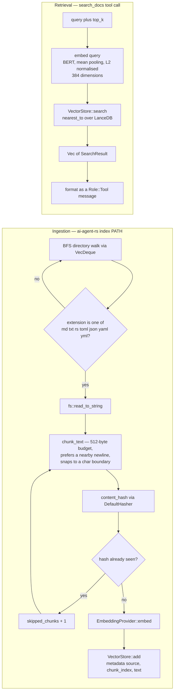
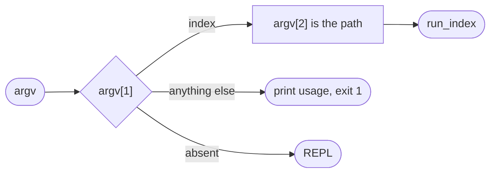

# Architecture

This document describes **what the system is and how it behaves** — module layout, control flow,
and data flow. The reasoning *behind* those choices (why a graph orchestrator, why `dyn` Trait
objects, which alternatives were rejected) lives in [Design Notes](design.md).

Diagrams are written in Mermaid and render natively on GitHub. Each section carries a bilingual
caption; node labels stay in English so they match the code identifiers they refer to.

## 1. System Composition

> 全体構成 — 実行時にどのモジュールがどう接続されるか

Two properties are worth calling out because they are easy to misread:

- **The tool count is conditional.** Five tools (`read_file`, `write_file`, `glob`, `grep`,
  `bash`) are registered unconditionally. `search_docs` is registered only when both the
  embedding provider and the vector store initialised successfully, so a run without RAG
  registers 5 and a full run registers 6.
- **`core/` is a leaf.** No feature module depends on another feature module; everything routes
  through `core/` (see §2).

## 2. Module Dependency Graph

> モジュール依存関係 — `core/` は最下位、`main.rs` が唯一の組み立て地点

Dependency rules, verified against every `use crate::` in `src/`:

| Rule | Evidence |
|------|----------|
| `core/` imports no other module | `core/provider.rs` is the only file with a `crate::` path, and it points at its own siblings |
| Feature modules never import each other except through declared seams | `agent → tools` (tool execution), `rag → tools` is the reverse (`tools/builtin/rag.rs → rag`), `agent → memory` |
| `main.rs` is the only module that touches all of them | `main.rs` declares `agent`, `config`, `core`, `llm`, `memory`, `rag`, `tools` |

`main.rs` selects the memory strategy (`MEMORY_STRATEGY`) and injects it into `GraphAgent`.
The agent depends only on the `ConversationMemory` trait, not on either concrete implementation.

## 3. Module Layout

### `src/core/` — Foundation

| File | Purpose |
|------|---------|
| `error.rs` | `AgentError` enum with 9 variants, `From` impls for serde/io/candle |
| `message.rs` | `Message`, `Role`, `ToolCall`, `ToolDef`, `LLMResponse`, `ToolResult` |
| `provider.rs` | `LLMProvider` trait (`chat`, `chat_stream`, `supports_streaming`) and `StreamingChunk` |

### `src/llm/` — LLM Backends

| File | Purpose |
|------|---------|
| `ollama.rs` | `OllamaProvider` — calls Ollama `/api/chat` with tool support + NDJSON streaming |
| `openai.rs` | `OpenAIProvider` — calls OpenAI-compatible `/chat/completions` + SSE streaming |
| `anthropic.rs` | `AnthropicProvider` — calls the Messages API `/v1/messages` + SSE streaming |

The active backend is selected by the `LLM_PROVIDER` environment variable. Adding another
provider means implementing `LLMProvider` and registering it in `create_provider()`
(`src/main.rs`) — see [Adding an LLM Provider](guides/adding-a-provider.md).

### `src/agent/` — Agent Orchestration

| File | Purpose |
|------|---------|
| `mod.rs` | `GraphAgent` — public API, wires graph + memory |
| `graph/mod.rs` | `GraphRunner` — hash-map-based node registry, loop until `__end__` |
| `graph/state.rs` | `State` — holds `messages`, `context`, `next_node` |
| `graph/nodes/react.rs` | `LLMNode`, `ToolNode` — the two concrete node types |

### `src/tools/` — Tool System

| File | Purpose |
|------|---------|
| `mod.rs` | `Tool` trait, `ToolEngine` registry |
| `builtin/read_file.rs` | Read file contents |
| `builtin/write_file.rs` | Write file with parent dir creation |
| `builtin/glob.rs` | Glob pattern matching |
| `builtin/grep.rs` | Regex search via `grep -rn` |
| `builtin/bash.rs` | Shell command execution (10,000-byte truncation) |
| `builtin/rag.rs` | `SearchDocsTool` — semantic search over indexed docs; only registered when RAG is up |

### `src/rag/` — Retrieval-Augmented Generation

| File | Purpose |
|------|---------|
| `embeddings.rs` | `EmbeddingProvider` trait, `CandleEmbeddingProvider` (BERT `all-MiniLM-L6-v2`) |
| `vector_store.rs` | `VectorStore` trait, `LanceVectorStore` (embedded LanceDB) |
| `indexer.rs` | `Indexer` — directory walk, 512-byte chunking, hash-based dedup; backs the `index` subcommand |

### `src/memory/` — Conversation Memory

| File | Purpose |
|------|---------|
| `mod.rs` | `ConversationMemory` trait — the seam `GraphAgent` depends on |
| `sliding.rs` | `SlidingWindowMemory` — `VecDeque<Message>` with max limit, preserves `System` messages |
| `summary.rs` | `SummaryMemory` — LLM-summarising long-term memory; enabled with `MEMORY_STRATEGY=summary` |

### `src/config.rs` — Configuration

Reads from the environment:

| Group | Variables |
|-------|-----------|
| Provider selection | `LLM_PROVIDER` |
| Ollama | `OLLAMA_HOST`, `OLLAMA_MODEL` |
| OpenAI | `OPENAI_API_KEY`, `OPENAI_MODEL`, `OPENAI_BASE_URL` |
| Anthropic | `ANTHROPIC_API_KEY`, `ANTHROPIC_MODEL`, `ANTHROPIC_BASE_URL`, `ANTHROPIC_MAX_TOKENS` |
| Vector store | `VECTOR_STORE_URI`, `VECTOR_TABLE_NAME` |
| Memory | `MEMORY_STRATEGY`, `MEMORY_MAX_MESSAGES`, `MEMORY_SUMMARY_THRESHOLD` |

Defaults live in the [Configuration Reference](reference/configuration.md) — this table is
intentionally a map of *which variable belongs to which group*, not a second source of truth.

## 4. Startup Sequence

> 起動シーケンス — RAG 初期化は失敗しても致命的ではない

The RAG subsystem is treated as **optional throughout**. If candle cannot load the model, or
LanceDB cannot open the table, startup logs a warning and continues with a reduced tool set
instead of aborting. The only hard failures at startup are selecting a cloud provider
without its API key (`OPENAI_API_KEY` or `ANTHROPIC_API_KEY`), which returns
`AgentError::LLMError` and exits.

## 5. Agent Execution Flow

> エージェント実行フロー — GraphAgent から GraphRunner への呼び出し

### ReAct routing, in detail

> ReAct ループの状態遷移 — 分岐と終了条件

`GraphRunner` itself is deliberately thin — a `HashMap<String, Arc<dyn Node>>` plus a
`state.next_node` read per iteration. It stops on `"__end__"` **and** on `next_node == None`,
so a node that forgets to route terminates the run rather than spinning.

`State.context` is the cross-node side channel. Keys written today: `iteration`,
`last_tool_count`, `last_tool_names`, `has_final_response`, `tool_results`.

## 6. RAG Pipelines

> RAG パイプライン — 取り込み（index）と検索（search_docs）の2系統

A per-file read error is logged and skipped rather than aborting the walk, so one unreadable
file does not fail an entire indexing run. Duplicates are detected at the **chunk** level, not
the file level, which is what keeps repeated boilerplate (license headers, identical config
snippets across files) from consuming vector-store space.

## 7. CLI Surface

> CLI ambig — サブコマンドは `index` のみ

The binary accepts exactly one subcommand, `index <path>`. Anything else prints usage and exits
with status 1. With no subcommand it starts the REPL.

`run_index` requires both RAG components; if either is `None` it prints
`RAG is not available. Cannot index documents.` and exits 1. On success it reports both the
chunk count and the skipped-duplicate count.

## 8. Error Handling

All errors use `AgentError` (this error). Key `From` impls allow `?` to convert:

- `serde_json::Error` → `AgentError::SerdeError`
- `std::io::Error` → `AgentError::IOError`
- `candle_core::Error` → `AgentError::CandleError`

One error variant is reused outside its nominal domain: `GraphRunner` reports an unknown node
name as `AgentError::RAGError` rather than adding a dedicated variant.

The full variant table is in the [API Reference](reference/api.md#error-types).

## Where to Read Next

| If you want to know… | Read |
|----------------------|------|
| Which module owns a file | [Module Layout](#3-module-layout) above |
| Why the graph orchestrator was chosen | [Design Notes §2](design.md#2-graph-型オーケストレーションを選んだ理由) |
| Why `Arc<dyn LLMProvider>` over `impl Trait` | [Design Notes §5.1](design.md#51-arcdyn-llmprovider-vs-impl-llmprovider) |
| How to add a tool, provider, or graph node | [Guides](guides/) |
| Every environment variable and its default | [Configuration Reference](reference/configuration.md) |
