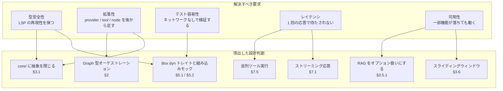

# AI Agent in Rust — 設計書

> この文書が扱うのは **「なぜそうしたか」** のみ。モジュール構成・実行フロー・依存関係などの
> 「何がどうなっているか」は [Architecture](architecture.md) を参照してください。
> 同じ内容を両方に書かないことで、仕様変更時の更新先が明確になります。

## 設計判断マップ

> 解決すべき要求と、そこから導出した設計判断の対応。
> 各ノードの `§` は本文の該当セクションを指します。



---

## 1. プロジェクト概要

### 1.1 目的

Rust の型安全性とパフォーマンスを活かし、**ローカル LLM（Ollama）**をバックエンドとする AI エージェントをゼロから構築する。RAG（検索拡張生成）と Graph 型オーケストレーションを統合し、複雑な推論タスクに対応可能にする。

### 1.2 なぜ Rust なのか

| 選定理由 | 詳細 |
|---------|------|
| **メモリ安全性** | 所有権・借用チェッカーにより、C++ のような UAF/ダングリングポインタの心配がない |
| **低レイテンシ** | ガベージコレクタ不要 — エージェントのツール呼び出しループにおいて一貫した応答性を実現 |
| **単一バイナリ** | `cargo build --release` で Ollama 以外の依存が不要な実行形式を生成 |
| **エコシステムの成長** | `candle`（ML推論）、`lancedb`（ベクトルDB）、`tokio`（非同期ランタイム）が成熟 |
| **学習コスト** | 既存の Python/TS フレームワーク（LangChain 等）の RAG/Graph の概念を Rust で再実装することで深く理解できる |

### 1.3 採用技術と選定理由

| コンポーネント | 採用技術 | なぜこの技術か | 代替候補と却下理由 |
|-----------|------|---------|---------|
| **LLM Backend** | Ollama | ローカル実行・API の OpenAI 互換性・GPU 不要でも動作 | vLLM（Python依存）、llama.cpp（FFI複雑） |
| **Vector DB** | LanceDB | サーバレス（エンベデッド）・Rust ネイティブ・Arrow ベース | Qdrant（サーバ要）、ChromaDB（Python） |
| **Embeddings** | candle + BERT | Pure Rust でモデル推論が可能・単一バイナリ化に貢献 | ort（ONNX ランタイム依存）、Python binding（FFI） |
| **Graph Logic** | 自作（Simple Graph） | LangGraph の概念を学びながら、過度な抽象化を避ける | LangGraph4j（Java依存）、petgraph（汎用グラフに不要な機能） |
| **非同期ランタイム** | tokio | Rust エコシステムの事実上の標準 | async-std（エコシステムが小さい） |
| **エラー処理** | thiserror | エラー型の自動導出でボイラープレートを削減 | anyhow（エラー型の明示性が犠牲に） |

---

## 2. Graph 型オーケストレーションを選んだ理由

構成図そのものは [Architecture §1「System Composition」](architecture.md#1-system-composition) に
あります。ここでは「なぜグラフにしたのか」だけを扱います。

**問題**: 単純な ReAct ループ（LLM → Tool → LLM → ...）では、以下の要件に対応できない。

1. **条件分岐**: ツールの結果に基づいて「別のツールを呼び出す」か「直接回答する」かを制御
2. **ループ制御**: 無限ループの防止（最大 25 回反復）
3. **状態の永続化**: ノード間で `context`（キーーバリュー）を共有
4. **拡張性**: 新しいノード（Planner, Evaluator 等）を既存コードを変更せずに追加

**解決策**: `GraphRunner` は名前付きノードの `HashMap` と、`state.next_node` によるルーティングで構成されるシンプルなステートマシン。

```rust
// agent/graph/mod.rs:29-51
pub async fn run(&self, mut state: State) -> Result<State, AgentError> {
    let mut current_node_name = self.entry_point.clone();
    loop {
        let node = self.nodes.get(&current_node_name).ok_or_else(|| {
            AgentError::RAGError(format!("Node {} not found in graph", current_node_name))
        })?;
        node.process(&mut state).await?;
        if let Some(next) = state.next_node.take() {
            if next == "__end__" { break; }
            current_node_name = next;
        } else {
            break;
        }
    }
    Ok(state)
}
```

**なぜ `petgraph` を使わないのか**: このプロジェクトのグラフは有向・サイクルを含むが、ノード数は極めて少ない（2-5個）。`petgraph` の拓扑排序・最短経路等の機能は不要で、`HashMap<String, Arc<dyn Node>>` + `next_node` フィールドで十分実装可能。

---

## 3. モジュール設計 — なぜその構成なのか

### 3.1 `core/` — コア抽象化

**目的**: 全モジュールが共通して使用する型とトレイトを定義。

#### 3.1.1 `AgentError` — 統一エラーティプ (`core/error.rs`)

```rust
#[derive(Debug, Error)]
pub enum AgentError {
    LLMError(String),
    ToolError(String),
    SerdeError(#[from] serde_json::Error),
    IOError(#[from] std::io::Error),
    ToolNotFound(String),
    RAGError(String),
    CandleError(#[from] candle_core::Error),
    VectorStoreError(String),
    EmbeddingError(String),
}
```

**なぜ単一のエラーenumなのか**:
- `?` オペレーターの連鎖を可能にする（`From` による自動変換）
- 呼び出し側で `match` による分岐が容易（`LLMError` はリトライ可能、`ToolNotFound` はフォールバック可能等）
- `thiserror` の `#[from]` で変換コードの自動生成

**なぜ `String` 包装が多いのか**: Ollama/LanceDB のエラー型を直接依存すると、外部ライブラリのバージョン変更が `AgentError` の定義に波及する。`String` で包むことで内部実装を隠蔽。

#### 3.1.2 `Message` — LLM 通信データモデル (`core/message.rs`)

```rust
pub struct Message {
    pub role: Role,
    pub content: String,
    pub tool_calls: Option<Vec<ToolCall>>,
    pub tool_call_id: Option<String>,
}
```

**なぜ OpenAI 互換フォーマットなのか**:
- Ollama の `/api/chat` エンドポイントが OpenAI 互換フォーマットを使用
- 今後 OpenAI/Anthropic プロバイダーを追加する際、メッセージ形式の変換が最小限で済む
- `serde(rename_all = "snake_case")` で JSON シリアライズが自動化

**なぜ `tool_call_id` が Option なのか**: `Role::User` と `Role::Assistant` のメッセージには tool_call_id が不要。`skip_serializing_if` と組み合わせて不要フィールドを省略。

#### 3.1.3 `LLMProvider` — LLM バックエンド抽象化 (`core/provider.rs`)

```rust
#[async_trait]
pub trait LLMProvider: Send + Sync {
    async fn chat(&self, messages: &[Message], tools: &[ToolDef]) -> Result<LLMResponse, AgentError>;

    async fn chat_stream<'a>(
        &'a self,
        messages: &'a [Message],
        tools: &'a [ToolDef],
    ) -> Result<BoxStream<'a, Result<StreamingChunk, AgentError>>, AgentError>;

    fn model_name(&self) -> &str;

    fn supports_streaming(&self) -> bool;
}

pub struct StreamingChunk {
    pub content: Option<String>,
    pub tool_calls: Option<Vec<ToolCall>>,
    pub done: bool,
}
```

`chat_stream` と `supports_streaming` は既定実装を持つため、`chat` と `model_name` のみを実装すれば
トレイトを満たす。ストリーミングに対応しないプロバイダーはこの既定実装で動作する。詳細は §7.1。

**なぜ `async_trait` なのか**: Rust のネイティブ async fn in trait は `Send` bound の指定が複雑。`async_trait` マクロで `Pin<Box<dyn Future + Send>>` に変換し、`Arc<dyn LLMProvider>` の所有権モデルと整合。

**なぜ `tools: &[ToolDef]` を引数に含めるのか**: Ollama は `tools` フィールドで利用可能なツールのスキーマを受け取る。プロバイダーごとにツール定義の形式が異なる場合があるため、呼び出し側で変換するよりも提供側に渡す方がシンプル。

---

### 3.2 `llm/` — LLM プロバイダー実装

#### `OllamaProvider` (`llm/ollama.rs`)

**なぜ `reqwest` の同期クライアントではなく `async` なのか**:
- `tokio` ランタイム上でブロッキング HTTP を使うとランタイムを停止させる
- Ollama の応答は数秒かかる場合があり、非同期でないと REPL のレスポンス性が悪化

**なぜリクエストに `stream` フラグを持たせるのか**:
- Ollama の `/api/chat` は `stream` フラグで非同期 NDJSON 応答を切り替える（§7.1 で実装済み）
- `chat()` は `stream: false`、`chat_stream()` は `stream: true` を送る
- 現在の `LLMNode` は `supports_streaming()` が真なら `chat_stream()` を呼び、false の場合は
  `chat()` にフォールバックする。`OllamaProvider` / `OpenAIProvider` はいずれも true を返す

**内部型の設計**:
```rust
struct OllamaTool { r#type: String, function: OllamaToolFunction }
struct OllamaRequest { model: String, messages: Vec<Message>, tools: Vec<OllamaTool>, stream: bool }
```
Ollama API の形式に合わせてラッパー型を定義。`ToolDef` → `OllamaTool` の変換は `chat()` 内で完結し、呼び出し側は意識しない。

---

### 3.3 `agent/` — エージェントオーケストレーション

#### 3.3.1 `GraphAgent` (`agent/mod.rs`)

**なぜ `GraphAgent` が `GraphRunner` と `SlidingWindowMemory` を持つのか**:

```
GraphAgent
├── runner: GraphRunner     ← 実行エンジン（ステートレス）
└── memory: SlidingWindowMemory  ← 会話履歴（ステートフル）
```

**設計判断**:
- `GraphRunner` は単発の `run(State)` を実行するだけ。会話履歴の管理は責務外
- `SlidingWindowMemory` が `VecDeque` で直近 20 メッセージを保持
- `run()` の戻り値から **差分**（新しいメッセージだけ）を memory に追加

```rust
// agent/mod.rs:30-51
pub async fn run(&mut self, user_input: &str) -> Result<String, AgentError> {
    let mut state = State::new();
    state.messages.extend(self.memory.get_history());  // 既存履歴を復元
    state.messages.push(Message { role: Role::User, ... });  // ユーザー入力を追加
    let final_state = self.runner.run(state).await?;
    // 差分を memory に追加
    let history_len = self.memory.get_history().len();
    for msg in final_state.messages.iter().skip(history_len) {
        self.memory.add(msg.clone());
    }
    ...
}
```

**なぜ差分管理なのか**: `State` は `run()` 内で全メッセージを保持するが、`SlidingWindowMemory` は永遠にメッセージを蓄積しない。毎回 `state.messages` を丸ごと保存すると、古いメッセージが復元→削除の無駄なコピーが発生する。

#### 3.3.2 `GraphRunner` — ステートマシン (`agent/graph/mod.rs`)

**なぜ `Arc<dyn Node>` なのか**:
- ノードは `run()` 呼び出し間で共有される可能性がある（将来の並列実行）
- `Arc` で所有権を共有し、`dyn Node` で動的ディスパッチ

**ルーティングの設計判断**:
- `state.next_node` は `Option<String>`。`None` は「終了」、`Some("__end__")` も「終了」
- なぜ2つの終了条件があるのか: ノードが明示的に `__end__` をセットする場合と、何もセットしない場合（デフォルトで停止）の両方をサポートするため

#### 3.3.3 `LLMNode` + `ToolNode` — ReAct ループ (`agent/graph/nodes/react.rs`)

**LLMNode の処理フロー**:

```
1. 反復回数を確認（最大25回）→ 超過エラー
2. system_prompt を先頭に挿入
3. LLM に chat() を呼ぶ
4. tool_calls が空でなければ:
   - assistant メッセージ（tool_calls付き）を state に追加
   - next_node = "tools"
5. tool_calls が空で content があれば:
   - assistant メッセージを state に追加
   - next_node = "__end__"
6. どちらもなければエラー
```

**なぜ反復回数を `state.context` に保存するのか**:
- `State` はノード間で共有される
- `LLMNode` 自体はステートレス（`&self` で process を呼ぶ）
- 反復回数は `context["iteration"]` として管理し、毎回インクリメント

**なぜ空の tool_call 名をフィルタリングするのか** (`react.rs:71-76`):
- Ollama が空の `function.name` を返すケースが報告されている
- `ToolNode` で `ToolNotFound` エラーになるのを事前回避

**ToolNode の処理フロー**:

```
1. 直近の assistant メッセージから tool_calls を取得
2. 各 tool_call を ToolEngine.execute() で実行
3. 結果を Role::Tool メッセージとして state に追加
4. next_node = "llm"（次の推論ステップへ）
```

**なぜツール結果を個別の `Role::Tool` メッセージとして保存するのか**:
- OpenAI 互換フォーマットでは、`tool_call_id` でツール呼び出しと結果を紐付ける
- 複数のツール呼び出しが同時に発生した場合、結果の順序を保証する必要がある

---

### 3.4 `tools/` — ツールシステム

#### 3.4.1 `Tool` トレイトと `ToolEngine` (`tools/mod.rs`)

```rust
#[async_trait]
pub trait Tool: Send + Sync {
    fn name(&self) -> &str;
    fn description(&self) -> &str;
    fn parameters(&self) -> Value;  // JSON Schema
    async fn call(&self, args: Value) -> Result<String, AgentError>;
}
```

**なぜ `parameters()` が `serde_json::Value` なのか**:
- ツールの引数スキーマは JSON Schema 形式
- 厳密な型定義（`struct ToolParams`）を各ツールで定義するとボイラープレートが増える
- `Value` で渡すことで、LLM が生成した引数をそのまま受け取れる

**`ToolEngine` の設計判断**:

```rust
pub async fn execute(&self, tool_call: &ToolCall) -> Result<ToolResult, AgentError> {
    // 引数が文字列の場合の二重パース対応
    let args_value = match &tool_call.function.arguments {
        Value::String(s) => serde_json::from_str(s).unwrap_or(tool_call.function.arguments.clone()),
        other => other.clone(),
    };
    ...
}
```

**なぜ引数の二重パースがあるのか**:
- Ollama は `arguments` を `String`（JSON文字列）で返すことがある
- 他のプロバイダーは `Object`（JSON値）で返す
- このフォールバックでプロバイダー差異を吸収

#### 3.4.2 ビルトインツール群

| ツール | 実装方針 | なぜその方針か |
|-------|---------|------------|
| `bash.rs` | `tokio::process::Command` + `sh -c` | 非同期でシェルコマンドを実行。`spawn_blocking` は使わない（プロセス起動は十分高速） |
| `read_file.rs` | `tokio::fs::read_to_string` | 非同期 I/O。大きなファイルでもブロックしない |
| `write_file.rs` | `create_dir_all` + `write` | 親ディレクトリを自動作成。エージェントがファイルパスを正確に指定できない場合の救済 |
| `glob.rs` | `glob` クレート + `spawn_blocking` | `glob` は CPU 密集型。`spawn_blocking` で非同期ランタイムをブロックしない |
| `grep.rs` | `Command::new("grep").arg("-rn")` | 正規表現検索を外部 `grep` に委譲。Rust 側で grep を再実装する必然性がない。シェルを介さず直接起動するので、引数はそのまま `grep` に渡される |
| `rag.rs` | `EmbeddingProvider` + `VectorStore` | RAG 検索をツールとして提供。エージェントが `search_docs` を呼び出して知識を取得 |

**なぜ `grep` は外部プロセスに委譲するのか**: Rust の `grep` クレート（ripgrep）は高速だが、パラメータ解析・ファイルフィルタ等の機能が豊富で、ツールとして必要な機能と過剰に適合する。`Command::new("grep")` で直接起動すれば十分な機能を提供でき、実装コストが大幅に低い。`sh -c` を経由しないのは、引数をそのまま `grep` に渡して余分なクォート処理を避けるため。

---

### 3.5 `rag/` — RAG サブシステム

#### 3.5.1 なぜ RAG がオプションなのか

**設計判断**: RAG（Embedding + VectorStore）の初期化が失敗しても、エージェントは通常のツール機能で動作する。

```rust
// main.rs:40-68
let embedding_provider: Option<Arc<dyn EmbeddingProvider>> = match CandleEmbeddingProvider::new() {
    Ok(p) => Some(Arc::new(p)),
    Err(e) => {
        warn!("Failed to initialize embedding provider: {}. RAG features will be disabled.", e);
        None
    }
};
```

**なぜこのように設計するのか**:
- `candle` のモデル読み込みは CUDA/Metal の可用性に依存
- 初回起動時に HuggingFace からモデルをダウンロードする必要がある
- RAG なしでもエージェントは有用（ファイル操作、シェル実行等）

#### 3.5.2 `CandleEmbeddingProvider` (`rag/embeddings.rs`)

**なぜ `all-MiniLM-L6-v2` なのか**:
- 384次元と低次元で、ストレージと検索が効率的
- 22M パラメータと軽量で、CPU でも十分な速度
- `sentence-transformers` ファミリーで最も広く使われている

**デバイス検出の設計判断**:
```rust
let device = if candle_core::utils::cuda_is_available() {
    Device::new_cuda(0).unwrap_or(Device::Cpu)
} else if candle_core::utils::metal_is_available() {
    Device::new_metal(0).unwrap_or(Device::Cpu)
} else {
    Device::Cpu
};
```
**GPU が利用不可でも CPU で動作する**: エージェントの利便性を優先。GPU があれば速度が向上するが、必須ではない。

**Mean Pooling + L2 正規化**:
- BERT の出力はトークンごとのベクトル。Mean Pooling で単一ベクトルに集約
- L2 正規化でコサイン類似度が内積と等しくなり、検索が高速化

#### 3.5.3 `LanceVectorStore` (`rag/vector_store.rs`)

**なぜ接続を毎回再作成するのか** (`get_table()`):
```rust
async fn get_table(&self) -> Result<Table, AgentError> {
    let conn = connect(&self.uri).execute().await...;
    conn.open_table(&self.table_name).execute().await...
}
```
**設計判断**: LanceDB の `Table` は内部でファイルハンドルを保持する。長時間アイドル状態になるとハンドルが無効になる可能性がある。`get_table()` で毎回再接続することで、接続の鮮度を保つ（パフォーマンスを犠牲に simplicity を優先）。

**スキーマ設計**:
```
id: Utf8 (主キー)
vector: FixedSizeList<Float32> (384次元)
metadata: Utf8 (JSON文字列)
```
**なぜ `metadata` が JSON 文字列なのか**: LanceDB のネイティブ JSON タイプが制限される場合がある。`Utf8` で JSON を格納し、検索後にデシリアライズすることで柔軟性を確保。

#### 3.5.4 `Indexer` (`rag/indexer.rs`)

**チャンク戦略の設計判断**:
```rust
pub fn chunk_text(text: &str, chunk_size: usize) -> Vec<String> {
    // 512バイトの予算で分割し、直前の50バイトから末尾の改行を探す
    let mut end = (start + chunk_size).min(text.len());
    if end < text.len() {
        let search_start = end.saturating_sub(BREAK_SEARCH_BYTES);
        if let Some(offset) = text.as_bytes()[search_start..end]
            .iter().rposition(|&b| b == b'\n')
        {
            end = search_start + offset + 1;
        }
    }

    // バイト境界で切るとマルチバイト文字で panic するため、境界に合わせる
    end = text.floor_char_boundary(end);
    ...
}
```
- **512バイト**: BERT の最大長（512トークン）に合わせ、テキストの意味的なまとまりを維持
- **改行優先分割**: 言語的な完全性を保つ。50バイトのlook-backで改行を探す
- **文字境界へのスナップ**: バイト単位の切断は日本語などのマルチバイト文字で `panic` する。
  `floor_char_boundary` で直前の境界まで戻してから切り出す
- **BFS によるディレクトリ走査**: `VecDeque` で幅優先。深すぎるネストでもスタックオーバーフローを回避
- **チャンク単位の重複排除**: ハッシュはチャンクごとに計算するため、ファイル内の反復ヘッダも
  1 件として扱われる（§7.4）

---

### 3.6 `memory/` — 会話記憶

`GraphAgent` は `ConversationMemory` トレイト（`memory/mod.rs`）にのみ依存し、
`Box<dyn ConversationMemory>` として注入される。既定は `SlidingWindowMemory` で、
`MEMORY_STRATEGY=summary` を指定すると `SummaryMemory` に切り替わる（→ §7.2）。

#### `SlidingWindowMemory` (`memory/sliding.rs`)

**なぜスライディングウィンドウなのか**:
- LLM のコンテキストウィンドウは有限（Ollama のデフォルトモデルは 2048-8192 トークン）
- 会話履歴が長くなると、プロンプトがコンテキストウィンドウを超過する
- 直近 20 メッセージを保持することで、最新の文脈を維持しつつコンテキストを管理

**System メッセージの保持ロジック**:
```rust
fn enforce_limit(&mut self) {
    while self.messages.len() > self.max_messages {
        let has_system = self.messages.iter().any(|m| matches!(m.role, Role::System));
        if has_system && self.messages.front().is_some_and(|m| !matches!(m.role, Role::System)) {
            self.messages.pop_front();  // 最古の非Systemメッセージを削除
        } else if let Some(pos) = self.messages.iter().position(|m| !matches!(m.role, Role::System)) {
            self.messages.remove(pos);  // System以外の最古メッセージを削除
        } else {
            break;  // 全てSystemメッセージなら削除しない
        }
    }
}
```
**なぜ System メッセージを保持するのか**: System プロンプトはエージェントの振る舞いを定義する。これを削除すると、エージェントの性格やルールが失われる。

---

## 4. データフローを形づくる設計判断

処理の流れそのもの（ユーザー入力から応答まで、RAG の取り込みと検索）は
[Architecture §5「Agent Execution Flow」](architecture.md#5-agent-execution-flow) と
[§6「RAG Pipelines」](architecture.md#6-rag-pipelines) を参照してください。

その流れに込められた判断は、以下に分解して記載しています。

| フロー上の性質 | 設計判断の所在 |
|---------------|---------------|
| LLM 呼び出しとツール実行が別ノードに分れている | [§3.3.3](#333-llmnode--toolnode--react-ループ-agentgraphnodesreactrs) |
| 反復回数が 25 で頭打ちになっている | [§3.3.3](#333-llmnode--toolnode--react-ループ-agentgraphnodesreactrs) |
| ツール結果が並列に実行される | [§7.5](#75-並列ツール実行) |
| ストリーミング対応プロバイダーでは応答待ちが短い | [§7.1](#71-streaming-レスポンス対応) |
| チャンク単位の重複排除が入っている | [§7.4](#74-インデックス重複排除) |
| RAG 初期化失敗でも起動する | [§3.5.1](#351-なぜ-rag-がオプションなのか) |
| 記憶戦略を実行時に差し替えられる | [§3.6](#36-memory--会話記憶) |

---

## 5. なぜその設計判断をとったのか — トレードオフ

### 5.1 `Arc<dyn LLMProvider>` vs `impl LLMProvider`

| 手法 | 利点 | 欠点 |
|-----|------|------|
| `Arc<dyn LLMProvider>` (採用) | ランタイムでプロバイダーを切り替え可能。`LLMNode` と `SummaryMemory` で共有できる | vtable オーバーヘッド（実質無視） |
| `impl LLMProvider` (ジェネリクス) | 静的ディスパッチで高速 | 型が伝播し、`GraphAgent` の型定義が複雑化 |

**採用理由**: エージェントのパフォーマンスボトルネックは LLM の推論（数百ms〜数秒）。vtable のオーバーフォーヘッド（数ns）は無視できる。さらに `SummaryMemory` が要約生成に同じプロバイダーを使うため、`Arc` による共有が必要。

### 5.2 `Arc<dyn Tool>` vs `Box<dyn Tool>`

| 手法 | 利点 | 欠点 |
|-----|------|------|
| `Arc<dyn Tool>` (採用) | `ToolEngine` の Clone が可能 | 参照カウントのオーバーヘッド |
| `Box<dyn Tool>` | 所有権が明確 | `ToolEngine` を Clone できない |

**採用理由**: `ToolEngine` は `LLMNode` と `ToolNode` の両方で使用される。`Arc` で共有することで、`ToolEngine::clone()` が可能（実際は `Arc` のクローンのみ）。

### 5.3 スライディングウィンドウ vs サマリー化メモリ

| 手法 | 利点 | 欠点 |
|-----|------|------|
| スライディングウィンドウ (既定) | 実装が簡潔・予測可能・追加 LLM 呼び出しなし | 古い文脈が失われる |
| サマリー化メモリ (opt-in) | 長期記憶を保持 | 上限超過時に LLM 呼び出しが発生する |

**採用理由**: 既定は予測可能性とレイテンシを優先し、長期文脈が必要な場合だけ
`MEMORY_STRATEGY=summary` で切り替える。`SummaryMemory` は上限超過時に古い半分を要約し、
要約呼び出しが失敗した場合は通常の切り捨てにフォールバックする（可用性優先）。

### 5.4 `LanceVectorStore` の再接続 vs 接続プーリング

| 手法 | 利点 | 欠点 |
|-----|------|------|
| 再接続 (採用) | 実装が簡潔・接続の鮮度を保証 | 接続オーバーヘッド |
| 接続プーリング | 高速 | プーリングの管理が複雑・接続の無効化対応が必要 |

**採用理由**: エージェントのツール呼び出し頻度は低く（1回の対話で数回）、接続コストは無視できる。

---

## 6. 既知の制約と将来改善案

| 制約 | 現状 | 将来の改善 |
|------|------|---------|
| ~~ストリーミング未対応~~ | ✅ 解決（§7.1、`LLMNode` は `chat_stream()` を使用） | WebSocket/SSE によるストリーミング UI 連携（§8） |
| ツール出力の切り詰め | 10,000**バイト**で切り詰め（文字境界を保持） | LLM のコンテキストウィンドウに応じた動的調整 |
| ~~インデックスの重複~~ | ✅ 解決（§7.4、ハッシュベース重複排除） | 永続化済みハッシュ集合によるセッション跨ぎの重複排除 |
| エラー復旧 | RAG 初期化失敗時はツール無効化 | リトライ機構・フォールバック戦略 |
| ~~並列ツール実行~~ | ✅ 解決（`futures::join_all`） | ツールごとの並列度制御・タイムアウト |

---

## 7. 追加実装された機能

### 7.1 Streaming レスポンス対応

**問題**: 従来の `stream: false` では、LLM の応答が完了するまで数十秒間ブロックが発生。ユーザー体験が劣化。

**解決策**: `LLMProvider` トレイトに `chat_stream` メソッドを追加。

```rust
// core/provider.rs
pub trait LLMProvider: Send + Sync {
    async fn chat(&self, messages: &[Message], tools: &[ToolDef]) -> Result<LLMResponse, AgentError>;

    async fn chat_stream<'a>(
        &'a self,
        messages: &[Message],
        tools: &[ToolDef],
    ) -> Result<BoxStream<'a, Result<StreamingChunk, AgentError>>, AgentError>;

    fn supports_streaming(&self) -> bool;
}

pub struct StreamingChunk {
    pub content: Option<String>,
    pub tool_calls: Option<Vec<ToolCall>>,
    pub done: bool,
}
```

**なぜ BoxStream なのか**: `async fn` の戻り値としてストリームを返す場合、具体的な型が大きすぎる。`Box::pin` でヒープ確保し、型を.erase する。

**Ollama の実装**: `stream: true` でリクエストし、改行区切りの NDJSON を `unfold` で処理。`acc_content` と `acc_tools` を蓄積し、`done: true` のチャンクで最終結果を返す。

**OpenAI の実装**: SSE（Server-Sent Events）形式の `data: {...}` チャンクを処理。`data: [DONE]` でストリーム終了。

**設計判断**: `LLMNode` は `provider.supports_streaming()` が真なら `chat_stream()` を呼び、`StreamingChunk` を `done: true` まで蓄積してから `LLMResponse` を組み立てる（`graph/nodes/react.rs`）。偽の場合は `chat()` にフォールバックする。`OllamaProvider` と `OpenAIProvider` はいずれも `supports_streaming() == true` を返すため、現状の実リクエスト経路では常にストリーミングが使われる。

チャンクを蓄積してから初めて REPL に返すため、まだユーザーが感じるレイテンシ低減には
つながっていない。ストリーミングが有効なのはプロバイダー間のリクエスト経路においてのみ。
次のステップは、蓄積したチャンクを逐次 UI へ流すこと（§8「Streaming UI 連携」）。

### 7.2 長期記憶 (SummaryMemory)

**統合状況**: ✅ `GraphAgent` は `ConversationMemory` トレイト越しに記憶を受け取る。
`main.rs` が `MEMORY_STRATEGY` に応じて `SlidingWindowMemory`（既定）か
`SummaryMemory` を構築して注入する（`agent/mod.rs`）。要約生成には推論と同じ
`Arc<dyn LLMProvider>` を共有する。

**問題**: `SlidingWindowMemory` は直近 20 メッセージのみ保持。古い会話の重要な文脈（「前に〇〇と言ったね」等）が失われる。

**解決策**: LLM を使って古いメッセージを要約し、`System` メッセージとして保持。

```rust
// memory/summary.rs
pub struct SummaryMemory {
    messages: VecDeque<Message>,
    max_messages: usize,       // 最大保持数（例: 20）
    summary_threshold: usize,  // 要約開始の閾値（例: 12）
    provider: Arc<dyn LLMProvider>,
    summary: Option<String>,   // 蓄積された要約
}
```

**動作フロー**:
1. メッセージが `summary_threshold` を超えると要約を開始
2. 半分のメッセージを LLM に渡して要約を生成
3. 既存の要約と結合（`"{}\n\n{}"` で結合）
4. 要約したメッセージを削除し、残りを保持
5. `get_history()` で要約 + 残りのメッセージを返す

**なぜ LLM で要約するのか**: 単純な切り捨て（SlidingWindowMemory）よりも情報の損失が少ない。要約プロンプトで「重要な情報・決定事項」を抽出させる。

**フォールバック**: LLM 呼び出しが失敗した場合は通常の切り捨てにフォールバック。可用性を優先。

### 7.3 OpenAI プロバイダー

**問題**: 従来は Ollama（ローカル）のみ対応。クラウド LLM を使えない。

**解決策**: `OpenAIProvider` を実装し、`LLM_PROVIDER` 環境変数で切り替え可能に。

```rust
// llm/openai.rs
pub struct OpenAIProvider {
    client: Client,
    api_key: String,
    model: String,
    base_url: String,  // カスタムエンドポイント対応
}
```

**なぜ `base_url` を持たせるのか**: OpenAI 互換 API（Azure OpenAI, Ollama の OpenAI エンドポイント, vLLM 等）に対応するため。

**設定方法**:
```bash
LLM_PROVIDER=openai
OPENAI_API_KEY=sk-...
OPENAI_MODEL=gpt-4o
OPENAI_BASE_URL=https://api.openai.com/v1  # 省略可
```

**メッセージ変換**: `Message` → `OpenAIMessage` の `From` トレイトを実装。`Role::Tool` のメッセージは `tool_call_id` で紐付け。

### 7.4 インデックス重複排除

**問題**: 再インデックスで同じチャンクが重複して保存される。検索結果に同じコンテンツが複数表示される。

**解決策**: ハッシュベースの重複排除。

```rust
// rag/indexer.rs
impl Indexer {
    fn content_hash(text: &str) -> String {
        use std::collections::hash_map::DefaultHasher;
        use std::hash::{Hash, Hasher};
        let mut hasher = DefaultHasher::new();
        text.hash(&mut hasher);
        format!("{:x}", hasher.finish())
    }
}

// index_directory() 内
let hash = Self::content_hash(chunk);
if self.seen_hashes.contains(&hash) {
    debug!("Skipping duplicate chunk from '{}' index {}", file_name, i);
    continue;
}
self.seen_hashes.insert(hash);
```

**なぜ `DefaultHasher` なのか**: 標準ライブラリに含まれ、SHA-256 より高速。検索用の重複排除なので、衝突確率は問題にならない。

**なぜ `HashSet` をインスタンスメモリに持つのか**: 同一インデックス作業中のみ重複排除する。プロセス終了でリセットされる。永続化はしない（LanceDB 側で管理する方がシンプル）。

### 7.5 並列ツール実行

**問題**: LLM が複数のツール呼び出しを同時に要求した場合、順次実行だと遅い。例: `read_file("a.rs")` と `read_file("b.rs")` を同時に呼び出す場合。

**解決策**: `futures::join_all` で並列実行。

```rust
// agent/graph/nodes/react.rs (ToolNode)
let futures: Vec<_> = tool_calls
    .iter()
    .map(|tc| {
        let tools = self.tools.clone();
        let tc = tc.clone();
        async move { tools.execute(&tc).await }
    })
    .collect();

let results_raw = join_all(futures).await;
```

**なぜ `self.tools.clone()` なのか**: `ToolEngine` は `Clone` で、内部は `Arc<dyn Tool>` なので実質的に共有。各 future が独立した所有権を持つ必要がある。

**エラーハンドリング**: どのツールが失敗しても、他のツールの結果は保持される。失敗したツールには `Role::Tool` メッセージでエラー内容を返す。

**なぜ `tokio::spawn` ではなく `join_all` なのか**: `ToolEngine` は `Send` だが `'static` ではない可能性がある。`join_all` はスコープ内の future を実行するため、所有権の問題が少ない。

---

## 8. 今後の改善案

| 機能 | 状態 | 優先度 | 説明 |
|------|------|--------|------|
| Streaming UI 連携 | 準備完了 | 高 | `chat_stream` を使用したリアルタイム表示 |
| SummaryMemory の統合 | ✅ 完了 | — | `MEMORY_STRATEGY` で `sliding` / `summary` を切り替え |
| Web UI + Persistence | 未着手 | 中 | WebSocket ベースの対話 UI |
| セッション永続化 | 未着手 | 中 | SQLite への会話履歴保存 |
| エージェント間協調 | 未着手 | 低 | 複数エージェントの並列実行 |
